# QETTYQ — карта экранов и переходов

Версия: P0, Astana pilot  
Визуальные экраны: `design/generated/app-screens/`  
Источник точных состояний: `design/QETTYQ_44_ARTBOARD_SPEC.md`

## 1. Главный пользовательский flow

```mermaid
flowchart LR
  subgraph FIRST[Первый контакт · bottom navigation скрыта]
    B01[01 Bootstrap] -->|сессия восстановлена / продолжить| H02[02 Главный экран]
    H02 -->|chip Астана| C03[03 Выбор города]
    C03 -->|продолжить с Астаной| H02
    H02 -->|Настроить подборку| O04[04 Перед 15 выборами]
    O04 -->|Начать| S05[05 Свайп]
    S05 -->|вправо| S06[06 Интересно]
    S05 -->|влево| S07[07 Не сейчас]
    S06 --> S05
    S07 --> S05
    S05 -->|15 выборов / показать сейчас| T08[08 Время]
    T08 -->|Дальше| M09[09 Бюджет]
    M09 -->|Дальше| G10[10 География]
    G10 -->|Моя геопозиция| P11[11 Разрешение]
    G10 -->|Указать вручную| P12[12 Точка на карте]
    P11 -->|Разрешить один раз| Q13[13 Поиск и проверка]
    P11 -->|Указать вручную| P12
    P12 -->|Использовать точку| Q13
    Q13 -->|варианты готовы| F14[14 Для тебя]
    Q13 -->|не найдено| E42[42 Нет результатов]
    E42 -->|применить рекомендацию| Q13
    E42 -->|посмотреть вручную| MAP16[16 Карта]
  end

  H02 -->|Сразу к карте| MAP16
  H02 -->|composer| A27[27 Помощник]

  subgraph DISCOVERY[Основное приложение · постоянная нижняя навигация]
    F14 -->|карточка| D20[20 Детали события]
    F14 -->|нужно уточнить| U15[15 Uncertain bucket]
    F14 -->|карта| MAP16
    MAP16 -->|marker| MS17[17 Выбранное событие]
    MAP16 <-->|Карта / Список| ML18[18 Список]
    MAP16 -->|Фильтр| FL19[19 Фильтры]
    FL19 -->|Показать варианты| MAP16
    MS17 -->|Подробнее| D20
    ML18 -->|карточка| D20
    D20 -->|Маршрут| R24[24 Конструктор маршрута]
    D20 -->|внешний контакт / билет| EXT1((Источник))
    MS17 -->|+ в маршрут| R24
    PL21[21 Детали места] -->|Маршрут| R24
  end

  subgraph ROUTE[Маршрут и план]
    R24 -->|route provider доступен| READY26[26 Готовый план]
    R24 -->|provider недоступен| EST25[25 Оценка по прямой]
    EST25 -->|проверить| EXT2((Внешняя карта))
    READY26 -->|Начать план| ACTIVE[Активный план]
    READY26 -->|Открыть навигацию| EXT2
  end

  subgraph ASSISTANT[Помощник]
    A27 -->|пример / отправить запрос| A28[28 Уточнение]
    A28 -->|условия подтверждены| A29[29 Карточки результатов]
    A29 -->|На карте| MS17
    A29 -->|В маршрут| R24
    A29 -->|Источник| EXT1
  end

  subgraph PROFILE[Профиль, память и доверие]
    PR32[32 Профиль и память] -->|Источники| SRC33[33 Источники]
    PR32 -->|Приватность| PRIV34[34 Приватность]
    PRIV34 -->|Удалить все данные| CONF[Confirmation sheet]
    CONF -->|Подтвердить| H02
  end

  DEG43[43 Offline / provider fallback] -. заменяет недоступный модуль .-> MAP16
  DEG43 -. routing fallback .-> EST25
  DEG43 -. assistant fallback .-> F14
```

## 2. Постоянная нижняя навигация

После первого получения рекомендаций появляется dock из пяти разделов:

| Позиция | Раздел | Экран назначения | Что сохраняется при переходе |
|---:|---|---|---|
| 1 | Для тебя | 14 | текущие время, бюджет, фильтры |
| 2 | Карта | 16 | тот же candidate set, выбранная дата |
| 3 | Помощник | 27/текущий thread | локальный диалог и condition chips |
| 4 | Планы | 26/30 | текущий draft route и сохранённые планы |
| 5 | Профиль | 32 | интересы, языки, память и privacy settings |

Dock показывается на `14–23` и `27–34`. Он скрыт на `01–13`, `24–26`, `35–44`,
а также на полноэкранных permission/confirmation состояниях. На маршруте вместо
dock используется sticky action bar: так карта и список остановок получают больше
места, а пользователь не уходит со сценария случайным касанием.

## 3. Контракт кнопок

| Экран | Элемент | Результат | Тип перехода |
|---|---|---|---|
| 02 | Астана | 03 | bottom sheet overlay |
| 02 | Настроить подборку | 04 | push left |
| 02 | Сразу к карте | 16 | dissolve |
| 04 | Начать 15 выборов | 05 | push left |
| 05 | X / swipe left | 07 → следующая карточка | spring card motion |
| 05 | Heart / swipe right | 06 → следующая карточка | spring card motion |
| 05 | Undo | предыдущая карточка | reverse card motion |
| 10 | Моя геопозиция | 11 | overlay, затем browser permission |
| 10 | Указать вручную | 12 | push left |
| 14 | Подробнее / card tap | 20 | push left |
| 14 | Map tab | 16 | dissolve, контекст сохраняется |
| 16 | Marker | 17 | sheet expands + map pan |
| 16 | Карта / Список | 18 / 16 | no-reset switch |
| 16 | Filter | 19 | overlay |
| 17 | + | 24 | selected entity added once |
| 20 | Маршрут | 24 | push left |
| 20 | Contact / ticket | внешний URL | system browser/deep link |
| 24 | Сохранить план | 26/30 | local persistence |
| 24 | Открыть навигацию | внешний provider | explicit handoff |
| 27 | Example prompt | 28 | fills composer + clarification |
| 29 | На карте | 17 | same entity ID |
| 29 | В маршрут | 24 | same entity ID |
| 34 | Удалить данные | confirmation | bottom sheet overlay |

## 4. Важные запреты

- Нижний dock не показывать во время onboarding: он создаёт ложный выход из
  двухминутной настройки.
- Не создавать отдельные сущности для ленты, карты и чата. Везде используется
  один `candidateId` и один источник фактов.
- Back закрывает overlay раньше, чем покидает родительский экран.
- External handoff всегда явный: пользователь видит, что покидает QETTYQ.
- При сбое карты остаётся список; при сбое маршрута остаётся честная оценка;
  при сбое AI остаётся deterministic подбор и объяснение.

