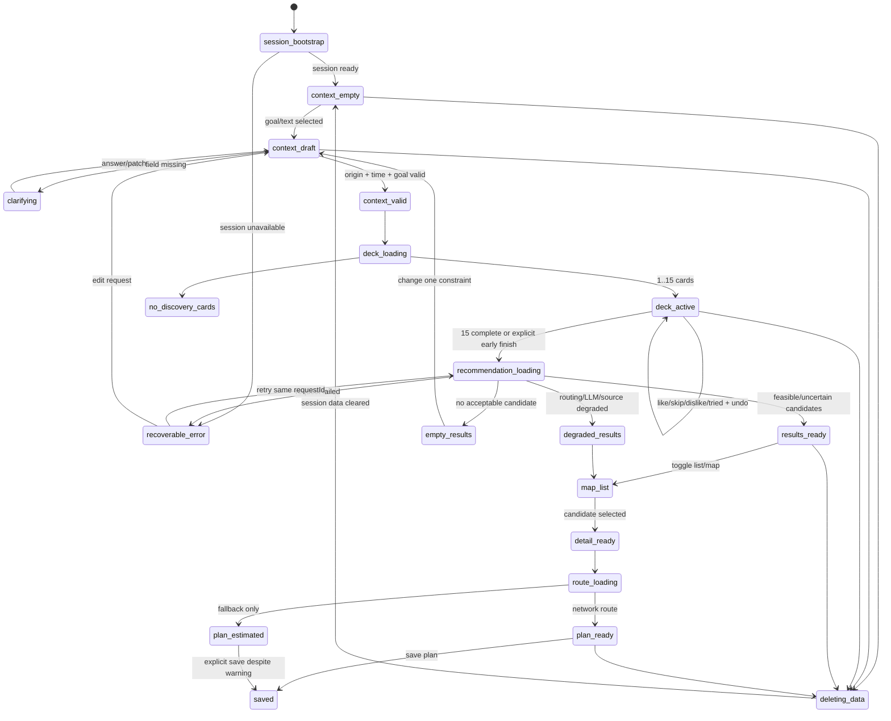

# A11 · Продуктовая логика QETTYQ для реального MVP Астаны

**Дата исследования:** 19 октября 2026 года  
**Область:** продуктовые сценарии, state machine, ranking/filtering, события, карта, маршрут, privacy и целевые API-контракты.  
**Статус документа:** проектное решение; этот отчёт не меняет существующие общие контракты и не утверждает, что описанная целевая логика уже реализована.

## 1. Вывод

Реальный MVP QETTYQ должен быть не «чатом, который советует место», а конечным автоматом принятия решения:

```text
валидный контекст
  → 5–15 реакций на идеи
  → детерминированный hard filtering
  → walking matrix / честный estimated fallback
  → ranking допустимых мест и occurrence
  → 1–3 объяснимых варианта
  → выбранный план A→P→B или A→P
```

Чат и LLM не выбирают место, не считают время и деньги и не создают события. Их роль — извлечь из текста исправляемый `contextPatch`, задать максимум два точных уточнения и объяснить уже проверенный результат.

Для пилота Астаны продуктовая единица выдачи — не просто `Place`, а `Candidate`:

- обычное место, которое можно посетить в интервале;
- конкретное событие `EventOccurrence` с подтверждённым временем начала;
- место для уточнения, если есть площадка, но нет occurrence; оно не называется «сеансом сейчас».

Критический порядок: **сначала допустимость, затем ranking, затем diversity, затем объяснение**. `unknown` не превращается в `false`, ноль, бесплатность или подтверждение.

## 2. Что подтверждено текущим проектом

### 2.1. Реализовано в коде

| Область | Фактическое состояние |
|---|---|
| Данные | 80 реальных POI Астаны из датированного OSM snapshot; название, категория, координаты и provenance |
| Поиск | `/api/recommendations` фильтрует по времени, приблизительному расстоянию, цели и интересам |
| Unknown | `price=null` сохраняется; вариант становится `uncertain`, а не бесплатным |
| Guest session | 24-часовой opaque token, `HttpOnly` cookie или header, in-memory storage |
| Реакции | `like`, `skip`, `dislike`, `tried`, `save`, idempotency key, sequence и profile version |
| Undo | Отмена последней активной реакции с полным пересчётом весов |
| Удаление | Удаление reactions/profile текущей сессии; anti-replay старых idempotency keys |
| AI | Provider interface, строгий JSON для OpenAI Responses, deterministic fallback при ошибке/отсутствии конфигурации |
| UI | Линейный путь start → limits → 15 карточек → results → approximate plan |

### 2.2. Пока является только прототипом или отсутствует

| Заявленная ценность | Разрыв текущей версии |
|---|---|
| «15 свайпов» | Есть 15 карточек и кнопки, но нет drag/swipe gesture; UI не вызывает reactions API, undo в UI отсутствует |
| Чат-ассистент | Первая фраза разбирается локальными regex только в `goal`; нет диалога, подтверждения извлечённых условий и серверной сессии чата |
| Персонализация | UI передаёт локальный массив `likedTags`; серверный профиль реакций не участвует в recommendations |
| Время и бюджет | Есть только `minutes` и budget на человека; нет `startAt`, `arriveBy`, party size, group basis, destination и opening interval |
| События | Модель occurrence и источник событий отсутствуют; это честно указано в UI и статусе |
| Карта | Нет карты и маркеров |
| Маршрут | Haversine + 4,5 км/ч; расчёт молча умножает путь на два, хотя пользователь не выбирал return-to-origin |
| Строгий ETA | Невозможен до сетевого walking route; текущий fallback должен оставаться `uncertain` |
| Error UX | Есть одно текстовое сообщение и empty result; нет отдельных offline, provider unavailable, stale, session expired состояний |
| Privacy UX | Backend delete существует, но пользовательский интерфейс удаления и bootstrap session не подключены |

## 3. Сверка с jury-facing PDF

Проверены все 9 страниц `exports/QETTYQ_APP_pitch.pdf` визуально и по извлечённому тексту.

### Что PDF отражает корректно

- Пилот обозначен как Астана и заявляет 80 snapshot POI, а не live-базу.
- Путь показан как «контекст → вкус → 1–3 варианта → план».
- Pipeline «real POI → constraints → ranking → explanation» соответствует правильному порядку.
- `UNKNOWN ≠ FREE`, guest TTL 24 часа и delete отражены как принципы доверия.
- Approximate route на UI-скриншоте помечен как estimated, а не точный walking route.
- Масштабирование на Алматы обозначено направлением, не состоявшимся запуском.

### Что нужно доказать продуктом до демонстрации жюри

1. **«15 свайпов»** должны создавать 15 серверных idempotent reactions либо демонстрация должна честно называться «15 карточек с кнопками». Сейчас это только локальное UI-состояние.
2. **Delete means delete** должен быть доступен из UI и проверен E2E, иначе жюри видит слайд, но не пользовательское действие.
3. Термин **«известность»** на ranking-слайде лучше заменить на «качество данных». Популярность и узнаваемость в текущем dataset не измеряются.
4. Маршрут на слайде допустим только с видимой подписью `estimated`; после подключения провайдера нужно показывать provider, профиль `foot-walking` и время расчёта.
5. Слайд с «Астана · пилот» использует футуристическую иллюстрацию, а не фотографию реального места. Она должна оставаться явно атмосферным artwork и не использоваться как evidence места или маршрута.
6. Footer `QARAGANDY / ASTANA PILOT` может запутать: Караганда — происхождение команды, Астана — единственный город покрытия MVP.
7. PDF не обещает events/map/chat, поэтому их добавление должно усиливать, а не менять главный тезис: «не список, а один проверенный путь».

## 4. Основной пользовательский сценарий

### 4.1. Happy path

1. Клиент вызывает `POST /api/session`; браузер получает 24-часовую guest session.
2. Человек выбирает цель или пишет: «Есть 90 минут, хочу выставку рядом, до 5000 ₸».
3. Assistant возвращает только предлагаемый `contextPatch`: goal, time window, budget, tags. Пользователь видит и может исправить извлечённые условия.
4. Если нет origin, UI просит геолокацию **после действия** либо предлагает ручную точку на карте/по сохранённым landmarks.
5. После валидного контекста открывается колода до 15 idea cards. Карты — идеи интереса, не обещания реальных сеансов.
6. Каждая реакция сохраняется один раз. `skip` скрывает карточку в текущей колоде, `like` слегка усиливает теги, undo полностью откатывает действие.
7. После 15 карточек — либо раньше после минимум пяти по явной кнопке — UI запрашивает рекомендации.
8. Сервер извлекает places и event occurrences, применяет hard filters, получает walking matrix, рассчитывает время/бюджет и делит кандидатов на feasible, uncertain, infeasible.
9. Ranking возвращает до трёх вариантов, желательно разных категорий. LLM или шаблон объясняет результат только по evidence.
10. На list/map пользователь выбирает один вариант. Сервер строит detail route A→P→B либо A→P, показывает дорогу, ожидание, посещение и запас.
11. «Сохранить» означает сохранить план, не бронь; «Открыть маршрут» — внешний navigation handoff, не подтверждённое посещение.

### 4.2. Быстрый путь без 15 реакций

Пятнадцать карточек — обещанный onboarding, но не блокировка продукта. После пяти реакций появляется «Показать варианты сейчас». Если пользователь сразу сформулировал точные категории, можно пропустить колоду. Это снижает abandonment и сохраняет честную семантику: отсутствие реакций означает отсутствие персонального boost, а не негативные предпочтения.

## 5. State machine



### Инварианты автомата

- Только `context_valid` может запускать discovery/recommendations.
- Новый `contextRevision` инвалидирует старую колоду, recommendation request и route preview.
- Поздний ответ старого request не меняет экран: клиент сравнивает `requestId` и `contextRevision`.
- `undo` разрешён только для последней неотменённой реакции текущей session.
- Из `route_loading` нельзя перейти в точный `plan_ready`, если provider не вернул сетевую геометрию и профиль `walk`.
- После delete текущие plans/reactions/profile исчезают; старый idempotency retry не восстанавливает реакцию.

## 6. Guest session и приватность

### P0 lifecycle

| Событие | Поведение |
|---|---|
| Первый запуск | Создать opaque session, cookie `HttpOnly; SameSite=Strict; Secure` на HTTPS, TTL 24 часа |
| Повторный запуск | Использовать живую session; не создавать новый профиль на каждом refresh |
| Session expired | `401 SESSION_REQUIRED`; UI тихо создаёт новую пустую session и сообщает, что временные реакции истекли |
| Logout отсутствует | Регистрация не нужна; вместо logout есть «Удалить мои данные» |
| Delete | Удалить reactions, preference profile и saved plans только этой session; точные координаты и чат-текст тоже не сохранять |
| Provider fail | Не логировать token, cookie, полный prompt или точные origin/destination |

Текущий in-memory store годится только для локального single-process прототипа. Реальный deploy требует persistent DB/TTL cleanup и shared idempotency/rate limit. Нельзя обещать persistence между рестартами или несколькими serverless-инстансами.

### Минимизация

- Точная геолокация хранится в клиентском active context и передаётся для одного расчёта; не попадает в URL, analytics или LLM evidence.
- Для LLM достаточно округлённых/вычисленных признаков: район, duration, detour, evidence IDs. Точные A/B не нужны.
- Исходный чат-текст можно не сохранять: после подтверждения остаётся структурированный context; технический trace содержит длину/статус, но не текст.
- Long-term profile (30 дней) только после отдельного opt-in; P0 по умолчанию session-only.

## 7. Механика 15 свайпов

### 7.1. Состав колоды

Колода строится из отдельного каталога `IdeaCard`, а не из событий. Каждая карточка имеет `ideaId`, `title`, `tags`, `category`, `energy`, `indoorOutdoor`, `noveltyBand`, illustration provenance и флаг `isIdea=true`.

Рекомендуемая структура 15 карт:

- 1–6: широкий baseline по еде, прогулке, культуре, творчеству, активности и спокойному отдыху;
- 7–12: адаптивные соседние темы на основе первых реакций, но минимум три категории;
- 13–15: контролируемое разнообразие — один близкий вариант, один соседний и один неожиданный безопасный вариант.

Нельзя выдавать карточку «Театр вечером» за активное событие. Подпись: «идея; проверим реальные сеансы после выбора».

### 7.2. Семантика действий

| Действие | Текущая колода | Session profile | Будущие колоды |
|---|---|---|---|
| `like` | Карта уходит вправо | `+1 / число уникальных тегов` | Небольшой boost |
| `skip` | Убрать карту до конца текущей колоды | 0 | Не считается dislike |
| `dislike` | Явная кнопка в details, не default left swipe | `-1 / число тегов` | Небольшой penalty |
| `tried` | Пометить опыт | 0 в интересах | Может повышать novelty, не является негативом |
| `save` | Только для реального candidate | Не подтверждает посещение | Сохраняет объект/план |
| `undo` | Вернуть последнюю карту и позицию | Полный пересчёт | Идемпотентно |

### 7.3. Надёжность

- Клиент создаёт UUID idempotency key до animation и повторяет тот же key при timeout.
- Optimistic UI допустим, но при `409`/`401` карточка возвращается и показывается actionable error.
- `deckId + sequence` защищают от реакции по старой колоде.
- Seen-set исключает дубли внутри 15 карточек.
- После 15/15 экран не зацикливает массив через modulo; он переходит к поиску или empty state.
- Gesture и кнопки вызывают один handler. Вертикальный scroll не должен превращаться в swipe; keyboard/screen reader проходят тот же путь.

## 8. Чат-ассистент

### 8.1. Продуктовая роль

Чат — ускоритель заполнения контекста, а не альтернативный бесконечный интерфейс. Он делает три операции:

1. извлекает исправляемый `contextPatch`;
2. задаёт одно конкретное уточнение за раз;
3. объясняет уже рассчитанные candidates.

Он не может менять ограничения, добавлять POI, считать маршрут, сообщать цену/наличие билета или делать booking.

### 8.2. Контракт понимания текста

```json
{
  "messageId": "client-uuid",
  "contextRevision": 3,
  "contextPatch": {
    "goal": "activity",
    "availableMinutes": 90,
    "budget": { "maxMinor": 500000, "currency": "KZT", "basis": "person" },
    "preferredTags": ["exhibition", "quiet"]
  },
  "needsConfirmation": ["budget.maxMinor"],
  "clarification": {
    "field": "origin",
    "question": "Откуда начинаем: выбрать точку вручную или использовать геолокацию?"
  }
}
```

`5000 ₸` хранится в минимальных единицах согласованной модели данных; UI никогда не угадывает basis. Слова «через час» и «на час» различаются: первое может означать start/arrive time, второе — duration window. При двусмысленности нужен вопрос.

### 8.3. Fallback без LLM

Детерминированный parser поддерживает числа времени, бюджет, четыре цели и небольшой словарь RU/KK tags. Неизвлечённое поле остаётся `null`. UI пишет «Помощник не уверен — проверь условия», а не симулирует понимание.

## 9. Hard filtering, feasibility и ranking

### 9.1. Сначала retrieval

1. Поддерживаемый город и географический bounding box Астаны.
2. Place/occurrence с разрешённым display и непросроченным provenance.
3. Категории, соответствующие цели; для `food` место должно иметь food category, но конкретное блюдо требует menu evidence.
4. Прямой георадиус — только prefilter перед routing matrix.
5. Events выбираются по occurrence, а не по зданию/organizer.

### 9.2. Hard filters

Кандидат исключается как `infeasible`, если подтверждено хотя бы одно:

- occurrence cancelled, ended или начинается до возможного прибытия;
- visit interval выходит за verified opening interval;
- `T_total > T_available`;
- подтверждённая верхняя/точная стоимость превышает budget после basis/party conversion;
- обязательное подтверждённое свойство ложно;
- место вне выбранного города/радиуса;
- category запрещена safety policy;
- route provider подтвердил отсутствие пешего маршрута.

Если поле важно, но неизвестно, результат — `uncertain`, а не `infeasible` и не `feasible`. В strict mode uncertain не входит в основную тройку; в soft mode показывается ниже с точной причиной.

### 9.3. Время

Для обычного места:

```text
T_total = T(A,P) + T_wait + T_visit + T(P,B) + T_buffer
```

`T(P,B)=0`, когда destination отсутствует и пользователь не выбрал return-to-origin. Текущий код всегда удваивает travel time; это нужно заменить явной логикой.

Для occurrence:

```text
arrival_at_P = startAt + T(A,P)
T_wait = max(0, occurrence.startAt - arrival_at_P)
visit_end = occurrence.endAt ?? occurrence.startAt + verifiedDuration
finish_at_B = visit_end + T(P,B) + T_buffer
```

Если `endAt` и duration неизвестны, строгая выполнимость не подтверждается. Все timestamps сохраняются в UTC с source timezone; для Астаны UI отображает `Asia/Almaty`.

### 9.4. Деньги

- `price=null` → unknown.
- Exact zero с evidence → бесплатно.
- `from` без max при строгом budget → uncertain даже если min укладывается.
- `basis=person` умножается на party size перед сравнением с group budget.
- Transport cost для walking P0 равен нулю как следствие выбранного mode, но не скрывает required fees.

### 9.5. Score только среди acceptable candidates

Нормализованные компоненты `[0,1]`:

```text
baseScore =
  0.35 * interestFit +
  0.30 * routeConvenience +
  0.20 * contextFit +
  0.15 * dataQuality
```

- `interestFit`: goal/category match + ограниченные session tag weights; один свайп не доминирует.
- `routeConvenience`: network detour/total walking time; Haversine fallback не получает максимальный score.
- `contextFit`: запас времени, budget headroom, event timing, indoor/outdoor match.
- `dataQuality`: provenance, freshness, известность ключевых полей. Это **не популярность места**.

Штраф `uncertain` применяется до финального sorting или такие кандидаты идут в отдельный bucket. `infeasible` не ранжируется.

Финальные 1–3 выбираются greedy rerank с diversity penalty: не более двух одинаковых primary categories, если есть допустимая альтернатива с близким score. Для goal=`new` novelty меняет порядок только среди допустимых кандидатов; не обходит время, бюджет и safety.

Tie-break детерминирован по `(score, dataQuality, routeMinutes, stable candidateId)`. Score не показывается пользователю как вероятность «вам понравится».

## 10. События с временем начала

### 10.1. Минимальная модель

```text
EventOccurrence
  id, activityId/placeId
  title
  startAt, endAt|null, timezone
  status: scheduled|rescheduled|cancelled|ended
  doorsAt|null
  bookingUrl|null
  price|null + basis/type/currency
  sourceUrl, sourceId, retrievedAt, validUntil
```

Многодневная выставка с диапазоном дат не получает выдуманное `startAt=00:00`. Для неё нужна модель open interval/venue hours; пока часов нет, она может показываться как «идёт в эти даты, время посещения уточнить», но не «успеете сегодня к 19:00».

### 10.2. Реальный кандидат источника

На дату исследования официальный Visit Astana показывает будущие мероприятия и даты, включая события октября–декабря 2026 года, но часть карточек имеет только диапазон дат, некоторые — без адреса, а ticket links ведут на сторонние платформы. Это подтверждает продуктовую ценность источника, но **не подтверждает API, лицензию на массовое сохранение или точное время начала**. До проверки terms и письменного/документированного способа получения источник остаётся `candidate`/`link_only`, не `approved_for_scope`.

Источник для исследования: <https://visitastana.kz/ru/> и раздел событий сайта. Нельзя использовать поисковую выдачу как ingestion API.

### 10.3. Поведение без event source

- Event tab показывает «Подтверждённых сеансов пока нет», а не конвертирует OSM theatre в афишу.
- Places остаются доступными как venue для самостоятельного уточнения.
- Chat не отвечает «сегодня концерт», если evidence содержит только theatre POI.
- Demo может использовать `synthetic_test` occurrence лишь с явной маркировкой, отдельно от public snapshot.

## 11. Карта и маркеры

### P0 behavior

- Переключатель `Список / Карта` использует один и тот же набор candidate IDs и одно selected state.
- На карте: origin `A`, optional destination `B`, до 12 candidate markers; итоговый plan показывает только выбранный `P`.
- Marker styles кодируют сущность и статус, не score: place, event, uncertain; cancelled/infeasible не показываются в основной выдаче.
- Selected marker открывает bottom sheet с теми же price/time/unknown/source, что карточка списка.
- Координаты пользователя не попадают в URL и share links.
- Attribution остаётся видимой поверх bottom sheet.

Если есть только Haversine, разрешены markers и круг/текст «по прямой», но запрещена линия, похожая на walking route. Polyline отображается только из route provider с `routeQuality=network`.

Tile provider, terms, quotas и attribution должны быть отдельно утверждены. Наличие OSM-данных не означает разрешение использовать стандартный tile server как production backend.

## 12. Route building

### Двухфазная стратегия

1. **Matrix phase:** один batched запрос `[A, candidates..., B]` к walking matrix для фильтрации и route score. Официальная документация openrouteservice подтверждает matrix durations/distances и профиль `foot-walking`; реальный аккаунт, quota и условия ещё нужно согласовать.
2. **Detail phase:** directions только для выбранного A→P и, если есть B/return, P→B. Хранить provider, profile, calculatedAt, distance, duration, geometry и attribution.

Официальные точки проверки: <https://giscience.github.io/openrouteservice/api-reference/endpoints/matrix/> и <https://giscience.github.io/openrouteservice/run-instance/configuration/engine/profiles/>.

### Fallback

| Состояние | Что можно показать | Что запрещено |
|---|---|---|
| Network route получен | duration, distance, polyline, provider/profile | Гарантия прибытия/безопасности |
| Provider timeout/rate limit | Haversine distance и оценочный диапазон | Точный ETA, polyline, `feasible` при строгом deadline |
| No route | Причина «пеший маршрут не найден» | Прямая линия как обход |
| Geometry отсутствует, duration есть | Время provider + markers | Выдуманная линия |

Для strict `arriveBy` estimated fallback делает результат `uncertain` либо исключает его по настройке `verified route required`.

## 13. Unknown, empty, fallback и error states

| Код/состояние | UI-текст | Действие |
|---|---|---|
| `SESSION_REQUIRED` | «Временная сессия истекла» | Создать новую; не утверждать, что реакции сохранены |
| `VALIDATION_ERROR` | Конкретное поле и допустимый формат | Вернуть к контексту, сохранить остальные поля |
| `UNSUPPORTED_CITY` | «Пилот пока работает только в Астане» | Ручной выбор Астаны; не подменять город автоматически |
| `NO_CANDIDATES` | Почему: время, budget, category или verified data | Предложить одно изменение, не ослаблять молча |
| `ROUTING_UNAVAILABLE` | «Показана оценка по прямой» | Повторить или продолжить с warning |
| `EVENT_SOURCE_UNAVAILABLE` | «Подтверждённых событий сейчас нет» | Перейти к places, не создавать event |
| `PROVIDER_UNAVAILABLE` (LLM) | «Показаны результаты поиска без AI-объяснения» | Не блокировать выдачу |
| `STALE_DATA` | «Данные получены …» | Открыть источник; не писать live |
| `RATE_LIMITED` | «Слишком много повторов; попробуйте позже» | Сохранить текущий UI, bounded retry |
| Offline | «Нет сети; несохранённое действие будет повторено» | Один queued retry с тем же idempotency key |
| Source field unknown | «Цена не указана», «Время нужно уточнить» | Source link; не общий vague warning |

Порядок degraded rendering: сохранённые facts → рассчитанные constraints → deterministic explanation → LLM enhancement. Медленный AI не блокирует карточки.

## 14. Целевые API-контракты

Ниже контракты для согласования A0. Они не означают, что endpoints уже существуют.

### Общая оболочка

```json
{
  "requestId": "uuid",
  "contextRevision": 4,
  "dataMode": "snapshot",
  "generatedAt": "2026-10-19T17:00:00Z",
  "warnings": [],
  "data": {}
}
```

Ошибка:

```json
{
  "requestId": "uuid",
  "error": {
    "code": "NO_CANDIDATES",
    "message": "Нет вариантов, которые помещаются в 30 минут.",
    "field": null,
    "retryable": false,
    "suggestion": { "field": "availableMinutes", "value": 60 }
  }
}
```

### Session/reactions — уже реализованная основа

- `POST /api/session` → expiresAt, reused; cookie/header token.
- `POST /api/reactions`, header `Idempotency-Key` → reaction, profile, sequence, replayed.
- `POST /api/reactions/undo`, header `Idempotency-Key` → отменённая reaction/profile.
- `DELETE /api/session/data` → deleted + removed counts.

Целевое дополнение: reaction input должен включать `deckId`/`contextRevision`, чтобы старый экран не менял новый профиль.

### `POST /api/assistant/messages`

Вход: `messageId`, `text` до 1000 символов, `contextRevision`, текущий структурированный context без cookie/token.  
Выход: `contextPatch`, `needsConfirmation`, `clarification|null`, `generationMode`.  
Ограничение: endpoint не возвращает место или маршрут.

### `POST /api/discovery`

Вход: валидный context, `contextRevision`, `limit=15`, optional seen idea IDs.  
Выход: `deckId`, `cards[]`, `minReactionsBeforeFinish=5`, `expiresAt`.  
Карточки явно имеют `kind=idea|place`; event occurrence не появляется без даты/status evidence.

### `POST /api/recommendations`

Целевой вход расширяет текущий:

```json
{
  "contextRevision": 4,
  "cityId": "astana",
  "goal": "activity",
  "origin": { "lat": 51.1282, "lon": 71.4304 },
  "destination": null,
  "returnToOrigin": false,
  "startAt": "2026-10-19T18:00:00+05:00",
  "arriveBy": null,
  "availableMinutes": 120,
  "budget": { "maxMinor": 500000, "currency": "KZT", "basis": "person", "partySize": 1, "strict": true },
  "constraints": { "indoorOnly": false, "childFriendly": false, "stepFreeRequired": false, "verifiedOpeningRequired": false }
}
```

Выход разделяет `items.feasible`, `items.uncertain`, `excludedSummary`, `routingMode`, `generationMode`, `datasetSnapshotAt`. Каждый item содержит `candidateId`, `kind`, price state, time breakdown, feasibility reasons, unknowns и evidence IDs.

### `POST /api/routes/preview`

Вход: `candidateId`, `contextRevision`; сервер повторно проверяет владельца context/plan.  
Выход: `segments[]`, `routeQuality=network|estimated|unavailable`, provider/profile, geometry nullable, total time и buffer. Клиент не передаёт произвольный provider URL.

### `GET /api/places/:id` и `GET /api/events/:occurrenceId`

Только разрешённые public fields, field-level provenance, last checked, unknown status и source URL. Booking link — внешний источник, не утверждение наличия.

### `POST /api/plans`

Сохраняет выбранный candidate и immutable calculation snapshot с TTL. Это не booking. Повторный request idempotent; чужая session получает 404, не раскрывающий существование plan.

## 15. P0/P1 план

### P0 — реальный вертикальный MVP

| Приоритет | Работа | Проверяемая приёмка |
|---|---|---|
| P0.1 | Подключить UI к guest session/reactions/undo/delete | S23/S24/S29 E2E; refresh не теряет session до TTL; delete доступен пользователю |
| P0.2 | Единый валидируемый context | null budget, zero budget, party/basis, startAt, destination/return semantics, Astana boundary tests |
| P0.3 | Настоящая колода 15 idea cards | Нет modulo-дублей; кнопки/gesture/keyboard эквивалентны; early finish после 5 явно доступен |
| P0.4 | Переписать filtering/ranking как чистые этапы | Unit tests S01–S18; excluded reasons; unknown не становится feasible |
| P0.5 | Walking provider adapter + matrix batching | Provider/profile/attribution; A→P→B; timeout fallback; no fake polyline |
| P0.6 | Map list parity | Одни candidate IDs, origin/destination markers, visible attribution, no coordinates in URL |
| P0.7 | EventOccurrence model | Cancelled/rescheduled/start/end/timezone tests; без approved source выдача честно пустая |
| P0.8 | Один разрешённый events adapter или документированный blocker | Проверены terms/API; даты/время и provenance; если разрешения нет — никаких fake events |
| P0.9 | Assistant context parser | Исправляемый patch, ambiguity questions, deterministic fallback, no location sent to LLM |
| P0.10 | Error/degraded UX | Offline, session expiry, routing fail, LLM fail, stale snapshot, no candidates в E2E |
| P0.11 | Jury proof | Demo: 15 reactions → changed ranking → map → estimated/network route → delete; deck facts обновлены по фактическим тестам |

Порядок P0: session integration → context → deterministic constraints → routing matrix → results/map → occurrences → assistant → jury demo. Events adapter исследуется параллельно, но его отсутствие не должно блокировать places path.

### P1 — после устойчивого P0

- сохранённые планы и сравнение двух альтернатив;
- двухточечный мини-маршрут из двух POI;
- добровольный 30-дневный profile opt-in;
- полноценная KZ-localization;
- verified media/фотографии с лицензиями;
- дополнительные event providers и freshness scheduler;
- wheelchair profile только при корректных данных и без обещания абсолютной доступности;
- weather/daylight context с approved source;
- PWA/offline shell без кэширования точных координат и устаревших персональных планов;
- пилотные метрики: completion, time-to-plan, empty-result rate, grounding validity, constraint violations.

## 16. Decision log для A0

1. Пятнадцать свайпов — default calibration, не обязательная стена; early finish после пяти.
2. Left swipe — `skip`, explicit dislike — отдельное действие.
3. Place и EventOccurrence — разные candidates; venue не означает event.
4. `destination=null` не означает return-to-origin.
5. Haversine используется только prefilter/fallback, никогда как network route.
6. Ranking score означает внутренний порядок, не вероятность удовлетворённости.
7. Chat возвращает context patch, а не факты о городе без retrieval.
8. Map отображает тот же набор, что list; polyline только от provider.
9. Visit Astana — актуальный кандидат событий, но не approved ingestion source до проверки условий.
10. Current in-memory session — локальный режим; публичный deploy требует persistent shared storage.

## 17. Источники и доказательства

- `PRD.md`, особенно разделы 5, 6, 8, 10, 12 и 13.
- Текущий код: `src/app/page.tsx`, `src/domain/recommend.ts`, `src/app/api/recommendations/route.ts`, `src/server/session/**`, `src/server/providers/llm/**`.
- Текущий jury-facing PDF: `exports/QETTYQ_APP_pitch.pdf`, 9 страниц, визуально проверен полностью.
- Официальный Visit Astana: <https://visitastana.kz/ru/> — подтверждает наличие датированных карточек будущих событий; не подтверждает право ingestion/API.
- Официальная документация openrouteservice matrix: <https://giscience.github.io/openrouteservice/api-reference/endpoints/matrix/>.
- Официальная документация openrouteservice profiles: <https://giscience.github.io/openrouteservice/run-instance/configuration/engine/profiles/> — содержит `foot-walking`; quota/аккаунт и deployment terms проверяются отдельно.

## 18. Точка остановки

Продуктовая логика, state machine, ranking/filtering, события, карта, routing, fallback/privacy и целевые API-контракты спроектированы. Код и общие контракты не изменялись. Следующий проверяемый шаг A0 — утвердить `UserContext` и `Candidate/Occurrence` schema, затем распределить P0.1–P0.6 по владельцам без параллельного редактирования общих файлов.
